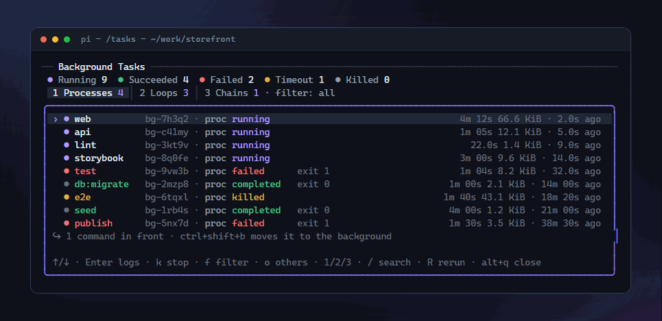
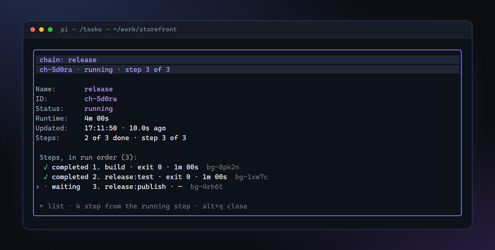
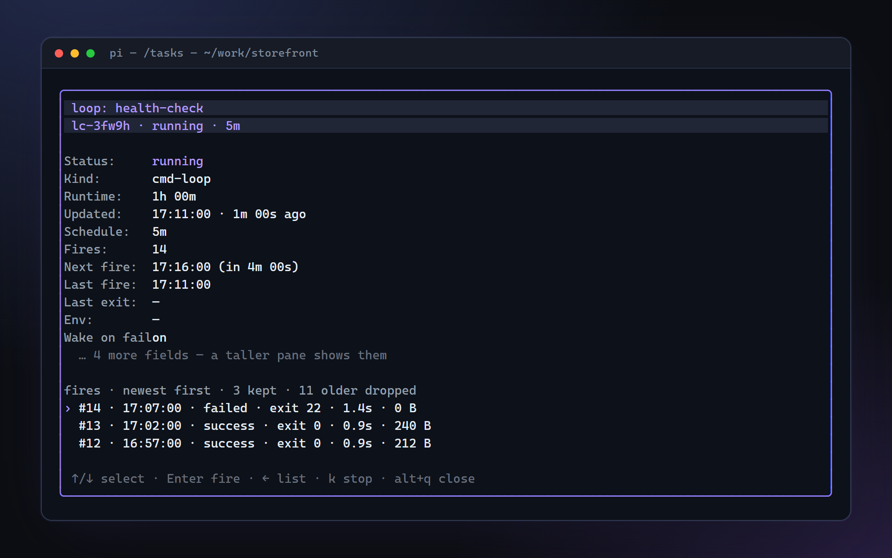
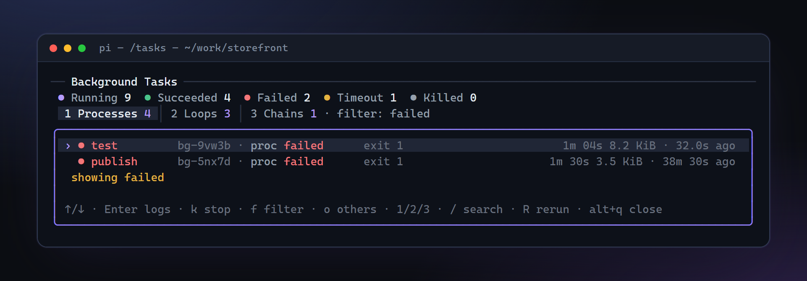
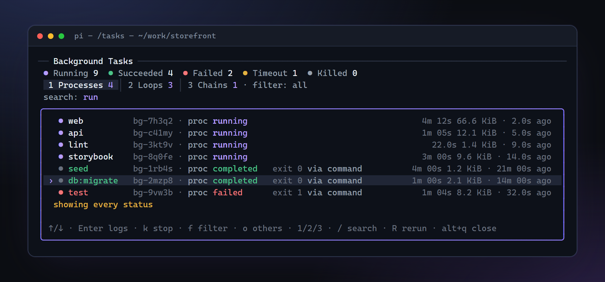
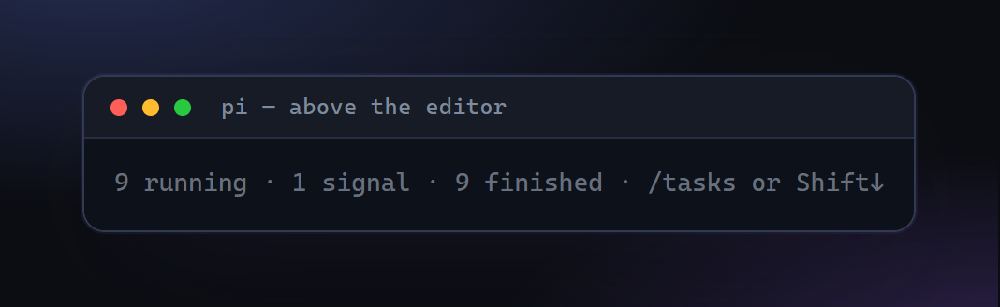
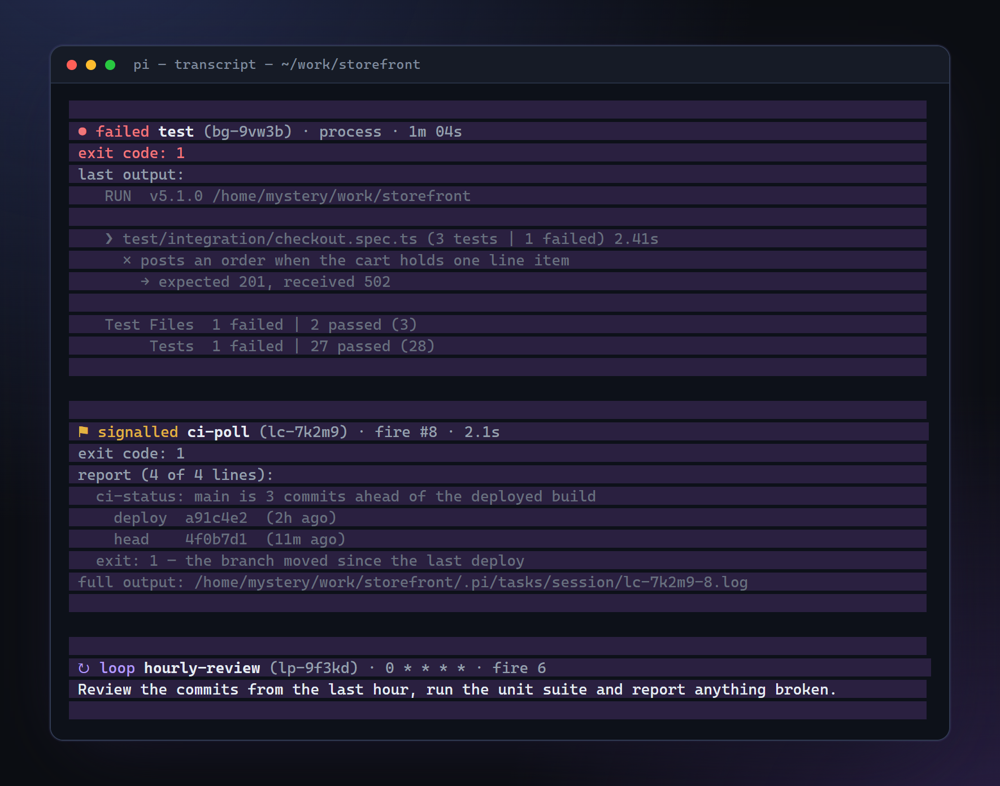
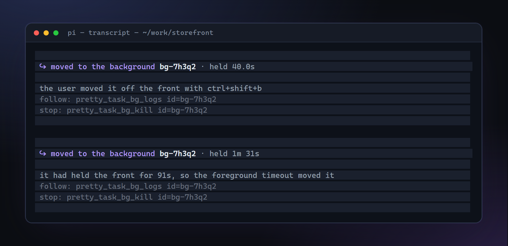

# pi-pretty-task

Background processes and scheduled agent wake-ups for [pi](https://github.com/earendil-works/pi), behind one panel.

[](https://github.com/mystery4f/pi-pretty-task/actions/workflows/verify.yml)
[](https://www.npmjs.com/package/pi-pretty-task)
[](LICENSE)


A build that takes six minutes. A watcher that runs all afternoon. A loop that wakes the model every ten minutes. They all land in the same list — readable, searchable, stoppable — and the output is still on disk when the turn is over.



## Install

```bash
pi install npm:pi-pretty-task
```

Requires pi and Node >= 22.19. A local checkout works too: `pi install ./path/to/pi-pretty-task`, or `pi install git:github.com/mystery4f/pi-pretty-task` for the latest `main`.

## Why use it

| You want to… | Use |
|---|---|
| Start a build, dev server or watcher and keep talking to the agent | `pretty_task_bg_run` |
| Wait for it without sleeping, polling or burning a turn | `pretty_task_bg_wait` |
| Read what it printed — or only what is new since last time | `pretty_task_bg_logs`, add `follow` |
| Find the one error in 40 MB of output | `pretty_task_bg_grep` |
| Stop it *and* its children, not just the parent pid | `pretty_task_bg_kill` |
| Run something after another job succeeds, instead of now | `pretty_task_bg_run` with `after` |
| Wake the agent on a schedule — interval or cron | `pretty_task_loop_create` |
| Fire that wake once more, now, without moving the schedule | `pretty_task_loop_fire` |
| Find out what that wake-up actually did | `pretty_task_loop_list` with an id |
| Just look at everything | `/tasks`, or `shift+down` |

## One panel, three records

- **Task** — a long-lived shell command in the background, watched, with its whole process tree killable. Output goes to a file, so "what did it print?" survives the turn.

  

- **Chain** — a command queued behind another task or chain instead of started now. A step is recorded as `waiting` and starts only after the step ahead ends with exit 0; a failing step leaves the ones behind it `skipped`. The chain's own page is the only place the queue is visible as a queue: every step in run order, a `›` on the one running, and the child record each step became (ADR-0013).

  

- **Loop / Iteration** — wake the LLM on a schedule with a preset prompt (`30s`/`10m`/`2h`, or five-field cron such as `0 9 * * 1-5`), and record every tool call of the turn that follows, so "what did that loop actually run?" has an answer.

  **What you see.** A fire that made no tool call prints its `0 calls` as a fact, and two in a row are marked — a turn that read files and thought before acting is not a stall on its first occurrence. A command loop has no iterations to record, so it keeps its fires instead: each one with its outcome, exit code, duration and size, newest first, with the older ones the history cap dropped counted rather than hidden.

  

  **What it says.** A turn pi is retrying after a provider error says so — `retry 2/4 · 529` on the loop row, and a Retry field on the iteration page — so four failed attempts are not mistaken for one slow one. When the provider finally gives up, that fire is counted: the loop keeps the error, the time and a run of consecutive failures, its row counts the run (`2 failed` beside the fire count) and its page prints the error the provider gave up with and reads that fire as `failed` rather than `completed`, and its next wake is pushed back instead of hammering a provider that is down — while a turn you stopped yourself counts for nothing. Wakes wait for an idle agent instead of interrupting a turn. A command loop that exits with one of the codes you declared as a signal is `signalled`, not failed: it keeps its schedule, and wakes you once per raised condition instead of once per fire.

  **Where the rules are.** [ADR-0001](docs/adr/0001-loop-wakes-llm-not-shell.md) (a fire is a turn, not a shell command), [ADR-0006](docs/adr/0006-cron-alongside-intervals.md) (cron beside intervals), [ADR-0007](docs/adr/0007-iteration-history-cap-and-restart-repair.md) (history cap and restart repair), [ADR-0009](docs/adr/0009-wakes-wait-for-idle-and-bind-their-turn.md) (wakes wait for idle), [ADR-0015](docs/adr/0015-loop-row-carries-a-fire-strip.md) (the fire strip), [ADR-0017](docs/adr/0017-overlap-skips-and-failures-back-off.md) (overlap skips, failures back off), [ADR-0018](docs/adr/0018-signal-outcome-and-minimum-fire-gap.md) (signal outcome and the minimum gap).

  

A fire that comes due while the previous one still runs is skipped and counted, never queued. An id says its kind on sight: `bg-` runs a command, `lp-` wakes the assistant, `lc-` runs a command on a schedule, `ch-` is a chain.

Deliberately not here: subagent/delegate/fusion tools, monitors-with-shell, workflow/orchestration families, provider-attested runs. See [docs/scope-v1.md](docs/scope-v1.md).

## The panel

Opens with `/tasks` or `shift+down`, and has three tabs — processes, loops, chains — plus five filters (`all`, `running`, `signal`, `failed`, `done`). One summary line above the editor stays after it closes; the footer row is shared with every other extension, so the count lives where it can be read.

List keys: `↑/↓` select, `Enter` open, `←` back, `k` stop, `a` stop all, `f` cycle filter (`all`/`running`/`signal`/`failed`/`done`), `o` toggle other sessions' records, `R` rerun, `c` show the output path, `/` search, `x` close from the list, `alt+q` close from anywhere (the first press leaves search mode).

```text
↑/↓ · Enter logs · k stop · f filter · o others · 1/2/3 tabs · / search · R rerun · a stop all · alt+q close
```


The filter keeps the reason on the row — a failure keeps its exit code and its runtime — and the header counts what the filter left out, so a narrowed list never reads as an empty session.



Search matches the name, the command and a loop's prompt at once, and keeps filtering after `alt+q` leaves the box.



With the panel closed, one line stands in for it: how many records are running, how many command loops have a raised signal, how many have ended, and the way back in. It is a widget (`PI_PRETTY_TASK` slot), so another extension cannot take the line, and it reprints after every change the extension makes.



Every image on this page is a screenshot of the shipped panel, not a mock-up: `npm run preview` renders them from `TasksPanel` itself, so a change in `src/ui/panel/` shows up in the next run instead of drifting away from the picture.

## What lands in the transcript

Three cards, one per kind of event, so a reader scrolling back does not have to open `/tasks` to know what happened: `task-finished` (status, name, id, duration, exit code, the reason if there is one, and the last lines of output), `loop-signal` (a command loop's fire that raised its condition, with the report it printed) and `loop-wake` (the prompt a fire delivered, exactly as the loop carries it). Each is a session message — the model reads the same facts — and each renders from its `details`, never from prose.



A fourth card, `task-detached`, is a session entry rather than a message: it records a command moved out of the front, and it is described under the takeover below.

## Use it

```text
pretty_task_bg_run    command: "npm run build", name: "build"
pretty_task_bg_status id: "bg-4xq81"
pretty_task_bg_logs   id: "bg-4xq81", follow: true
pretty_task_bg_grep   id: "bg-4xq81", pattern: "error"
pretty_task_bg_wait   id: "bg-4xq81", timeoutSeconds: 120
pretty_task_bg_kill   id: "bg-4xq81"

pretty_task_loop_create schedule: "10m", prompt: "Check the deploy and report drift."
pretty_task_loop_create schedule: "0 9 * * 1-5", command: "npm run nightly"
pretty_task_loop_update id: "lp-9f3kd", action: "pause"
pretty_task_loop_update id: "lp-9f3kd", prompt: "Check the deploy, and report only drift."
pretty_task_loop_fire   id: "lc-7k2m9"
pretty_task_loop_list   id: "lp-9f3kd"
pretty_task_loop_delete id: "lp-9f3kd"
```

`pretty_task_loop_update` also takes `resume`, `complete`, `rearm` (recompute the next fire from now on the same schedule, the way back onto a slot after a backoff) and `clear-signal` (drop a raised condition you have already dealt with, without waiting for a healthy round). `pretty_task_loop_fire` runs one fire of a command loop immediately without spending a schedule slot or touching the failure streak — the way to test a command before trusting it to a clock.

Stopping means the whole tree: SIGTERM, a grace period, SIGKILL, then a poll until the process group is really gone — grandchildren included. On Windows that is `taskkill /PID <n> /T`.

## A command in front can be let go

A long build is already running in front of you — the first frames of the animation above are this exact move. With `PI_PRETTY_TASK_ADOPT_FOREGROUND=on`, the built-in `bash` tool — and your own `!` commands — run through this extension, so `ctrl+shift+b` moves the one command currently in front to the background instead of killing it. The call ends with the output it had captured and a `↪ moved to bg-…` line, and the command keeps running as an ordinary task: `pretty_task_bg_logs`, `pretty_task_bg_status`, `pretty_task_bg_kill` all work on it.

Both triggers — the key and the deadline — end the call with the same shape and say which one it was (`ctrl+shift+b`, or `it had held the front for 91s`), so a model reading the transcript can tell a person's decision from a clock's. The move also leaves one card in the transcript naming the record and the trigger, so you learn it happened without opening `/tasks`; the card is part of the session, so it is still there after a reload, and it never enters the model's context.



`PI_PRETTY_TASK_FOREGROUND_TIMEOUT` does the same on a timer, for the terminal you have already walked away from; `0`, the default, never moves anything. A call's own `timeout` still stops the tree — a timeout is a failure, not a move. The takeover is off by default because it re-registers pi's own shell tools; see [ADR-0020](docs/adr/0020-foreground-command-detaches-to-a-task.md).

## Leave it running while you are away

A prompt loop is a clock: every fire delivers a message into the session and starts one turn. That is enough to keep a long job moving overnight, provided the work has somewhere to live and the loop knows when to stop.

- Keep the work in a progress file, one item per line with an acceptance check on each. "`npm run test:unit` exits 0" can be finished; "improve the code" cannot.
- Put a closing contract in the loop's prompt: tick the item that finished, and when nothing is left call `pretty_task_loop_update id=<id> action=complete`.
- Fine-tune the wording without touching the schedule: every fire reads the loop's prompt file (the path `pretty_task_loop_list` prints, and the loop's page in `/tasks` shows along with its first three lines and when the file last changed), so an edit takes effect on the next fire and deleting the loop deletes the file. The same change goes through `pretty_task_loop_update id=<id> prompt="…"` when the agent is the one refining the wording: the loop keeps its id, fire count and iteration history, the text given at create time stays the seed the file falls back to, and a write that cannot land leaves the old text in place and says so in the reply.
- Always pass `maxFires`. It is the only stop that does not depend on the model's own judgement.

The bundled `pretty-task-unattended` skill carries the whole recipe — the file shape, the exact contract text, and what to read the next morning. Ask for it in plain words ("run this unattended overnight") and it fills in the calls.

## Bundled skills

Two skills ship with the package and are offered by name: `pretty-task-unattended` (the overnight recipe above) and `pretty-task-templates` (adding or changing a command template — what the file must contain, which of the two files wins, and that an edit applies after `/reload`).

## Tools

| Tool | What it answers |
|---|---|
| `pretty_task_bg_run` | Start a command; also starts a chain step with `after`, or a named template with `template` |
| `pretty_task_bg_status` | Status, elapsed time, working directory, kill reason |
| `pretty_task_bg_logs` | The output tail, or `follow` for only what arrived since the last read |
| `pretty_task_bg_grep` | Matching lines of the whole output file |
| `pretty_task_bg_wait` | Wait for a task to end, up to 600 seconds |
| `pretty_task_bg_kill` | Stop the task and every process it started |
| `pretty_task_loop_create` | A schedule: an interval, a cron expression, or a command that runs on it |
| `pretty_task_loop_list` | The loops, or one loop's fires and the tool calls of each iteration |
| `pretty_task_loop_update` | Pause, resume, complete, retune the schedule, replace the prompt, rearm, or clear a raised signal |
| `pretty_task_loop_fire` | Run one fire of a command loop right now, off the schedule |
| `pretty_task_loop_delete` | Delete a loop and its prompt file |

## Configuration

Every key is read once at load; a value it cannot use fails the extension with the key name instead of silently falling back.

| Key | Default | Meaning |
|---|---|---|
| `PI_PRETTY_TASK_OUTPUT_CAP_BYTES` | `20971520` (20 MiB) | Output file cap; crossing it kills the tree with reason `output_cap` |
| `PI_PRETTY_TASK_MAX_RUNNING_TASKS` | `20` | Running process records per session, children and steps included |
| `PI_PRETTY_TASK_NOTIFY` | `on` | Write an OSC 9 notification to the terminal when a task ends |
| `PI_PRETTY_TASK_RETENTION_DAYS` | `7` | Session directories older than this are pruned at startup |
| `PI_PRETTY_TASK_SHELL` / `_SHELL_PATH` | `bash` | Windows shell (`cmd`, `bash`) and its absolute path; `bash.exe` comes from Git for Windows — the one pi was started from, then the `git` on PATH, the registry, the usual install dirs, then PATH |
| `PI_PRETTY_TASK_POSIX_SHELL` / `_POSIX_SHELL_PATH` | `bash` | POSIX shell (`inherit`, `bash`, `sh`) and its path |
| `PI_PRETTY_TASK_ADOPT_FOREGROUND` | `off` | Run pi's `bash` tool and `!` commands through this extension, so the command in front can be moved to a task; the `powershell` tool it registers has no such move |
| `PI_PRETTY_TASK_FOREGROUND_TIMEOUT` | `0` | Seconds before the command in front is moved to the background by itself; `0` never moves; either trigger says which one it was, once, in the tool result and on a card |

The OSC 9 notification rings once per task and only on an ending: `completed`, `failed`, `killed` and `interrupted` write `\u001b]9;<name> <status>\u0007`, a running or paused task writes nothing, and `PI_PRETTY_TASK_NOTIFY=off` silences all of it. A terminal that ignores OSC 9 shows nothing at all, which is why the same ending is also a card.

Command templates live in `<project>/.pi/pretty-task.json` and `~/.pi/agent/pretty-task.json`, project first, and are read once at load — a file edited mid-session applies after `/reload`. Adding or changing one is covered by the bundled `pretty-task-templates` skill.

Full detail, including the shell rules, decoding order and per-call `cwd`/`env`: [docs/configuration.md](docs/configuration.md).

## Documentation

Start at [AGENTS.md](AGENTS.md) for the product model and rules, and [GLOSSARY.md](GLOSSARY.md) for the vocabulary. Scope and decisions live in [docs/](docs/) — [docs/scope-v1.md](docs/scope-v1.md) and the ADRs under [docs/adr/](docs/adr/) — and the index for all of it is the wiki page [`.llm-wiki/wiki/syntheses/pi-pretty-task-文档索引.md`](.llm-wiki/wiki/syntheses/pi-pretty-task-文档索引.md). The screenshots and how they are made: [docs/previews.md](docs/previews.md).

## Development

```bash
npm install
npm run verify    # check + lint + test
npm run build     # emit dist/
npm run preview   # build, then re-render docs/preview*.{png,gif}
```

`npm run check` typechecks without emit, `npm run lint` is Biome, `npm run test` runs vitest over both projects, `npm run test:unit` the pure half in seconds. Style is machine-enforced by `.editorconfig` + Biome; `dist/` is build output and is never committed. [AGENTS.md](AGENTS.md) has the full verification list.

`npm run preview` drives the built panel with scripted keystrokes in a headless browser and writes the images on this page; it needs a Chrome or Edge on the machine (`PREVIEW_BROWSER` points at another one). `npm run preview:dump --only <label>` prints the same frames as text without a browser. [docs/previews.md](docs/previews.md) covers the frames and the colours.

## Releasing

Published to npm by [.github/workflows/publish.yml](.github/workflows/publish.yml) when a GitHub Release is published. Steps, token requirements and the traps: [docs/releasing.md](docs/releasing.md).

## License

MIT
