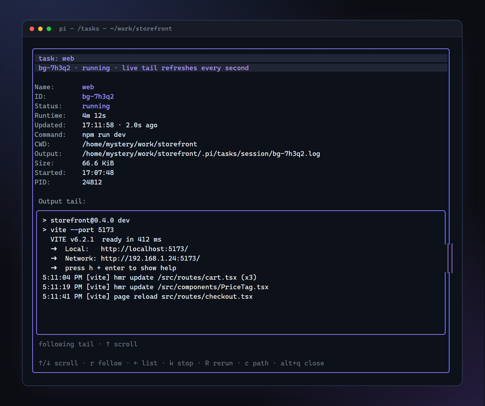
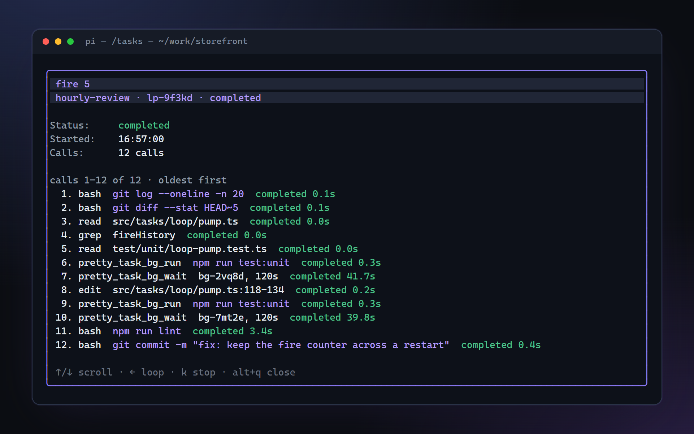
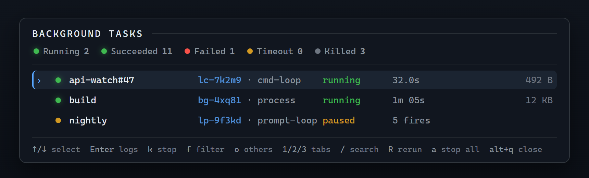

# pi-pretty-task

Background processes and scheduled agent wake-ups for [pi](https://github.com/earendil-works/pi), behind one panel.

[](https://github.com/mystery4f/pi-pretty-task/actions/workflows/verify.yml)
[](https://www.npmjs.com/package/pi-pretty-task)
[](LICENSE)


A build that takes six minutes. A watcher that runs all afternoon. A loop that wakes the model every ten minutes. They all land in the same list — readable, searchable, stoppable — and the output is still on disk when the turn is over.


## Install

```bash
pi install npm:pi-pretty-task
```

Requires pi and Node >= 22.19. A local checkout works too: `pi install ./path/to/pi-pretty-task`, or `pi install git:github.com/mystery4f/pi-pretty-task` for the latest `main`.

## Why use it

| You want to… | Use |
|---|---|
| Start a build, dev server or watcher and keep talking to the agent | `pretty_task_bg_run` |
| Wait for it without sleeping, polling or burning a turn | `pretty_task_bg_wait` |
| Read what it printed — or only what is new since last time | `pretty_task_bg_logs`, add `follow` |
| Find the one error in 40 MB of output | `pretty_task_bg_grep` |
| Stop it *and* its children, not just the parent pid | `pretty_task_bg_kill` |
| Run something after another job succeeds, instead of now | `pretty_task_bg_run` with `after` |
| Wake the agent on a schedule — interval or cron | `pretty_task_loop_create` |
| Find out what that wake-up actually did | `pretty_task_loop_list` with an id |
| Just look at everything | `/tasks`, or `shift+down` |

## One panel, three records

- **Task** — a long-lived shell command in the background, watched, with its whole process tree killable. Output goes to a file, so "what did it print?" survives the turn.

  

- **Chain** — a command queued behind another task or chain instead of started now. A step is recorded as `waiting` and starts only after the step ahead ends with exit 0; a failing step leaves the ones behind it `skipped`.
- **Loop / Iteration** — wake the LLM on a schedule with a preset prompt (`30s`/`10m`/`2h`, or five-field cron such as `0 9 * * 1-5`), and record every tool call of the turn that follows, so "what did that loop actually run?" has an answer. Wakes wait for an idle agent instead of interrupting a turn.

  

A fire that comes due while the previous one still runs is skipped and counted, never queued. An id says its kind on sight: `bg-` runs a command, `lp-` wakes the assistant, `ch-` is a chain.

Deliberately not here: subagent/delegate/fusion tools, monitors-with-shell, workflow/orchestration families, provider-attested runs. See [docs/scope-v1.md](docs/scope-v1.md).

## The panel

Opens with `/tasks` or `shift+down`, and has three tabs — processes, loops, chains. One summary line above the editor stays after it closes; the footer row is shared with every other extension, so the count lives where it can be read.

List keys: `↑/↓` select, `Enter` open, `←` back, `k` stop, `a` stop all, `f` cycle filter (`all`/`running`/`failed`/`done`), `o` toggle other sessions' records, `R` rerun, `c` show the output path, `/` search, `x` close from the list, `alt+q` close from anywhere (the first press leaves search mode).

```text
↑/↓ · Enter logs · k stop · f filter · o others · 1/2/3 tabs · / search · R rerun · a stop all · alt+q close
```



Every image on this page is a screenshot of the shipped panel, not a mock-up: `npm run preview` renders them from `TasksPanel` itself, so a change in `src/ui/panel/` shows up in the next run instead of drifting away from the picture.

## Use it

```text
pretty_task_bg_run    command: "npm run build", name: "build"
pretty_task_bg_status id: "bg-4xq81"
pretty_task_bg_logs   id: "bg-4xq81", follow: true
pretty_task_bg_grep   id: "bg-4xq81", pattern: "error"
pretty_task_bg_wait   id: "bg-4xq81", timeoutSeconds: 120
pretty_task_bg_kill   id: "bg-4xq81"

pretty_task_loop_create schedule: "10m", prompt: "Check the deploy and report drift."
pretty_task_loop_create schedule: "0 9 * * 1-5", command: "npm run nightly"
pretty_task_loop_update id: "lp-9f3kd", action: "pause"
pretty_task_loop_list   id: "lp-9f3kd"
```

Stopping means the whole tree: SIGTERM, a grace period, SIGKILL, then a poll until the process group is really gone — grandchildren included. On Windows that is `taskkill /PID <n> /T`.

## Tools

| Tool | What it answers |
|---|---|
| `pretty_task_bg_run` | Start a command; also starts a chain step with `after`, or a named template with `template` |
| `pretty_task_bg_status` | Status, elapsed time, working directory, kill reason |
| `pretty_task_bg_logs` | The output tail, or `follow` for only what arrived since the last read |
| `pretty_task_bg_grep` | Matching lines of the whole output file |
| `pretty_task_bg_wait` | Wait for a task to end, up to 600 seconds |
| `pretty_task_bg_kill` | Stop the task and every process it started |
| `pretty_task_loop_create` / `_list` / `_update` / `_delete` | A schedule, its fires, and its recorded iterations |

## Configuration

Every key is read once at load; a value it cannot use fails the extension with the key name instead of silently falling back.

| Key | Default | Meaning |
|---|---|---|
| `PI_PRETTY_TASK_OUTPUT_CAP_BYTES` | `20971520` (20 MiB) | Output file cap; crossing it kills the tree with reason `output_cap` |
| `PI_PRETTY_TASK_MAX_RUNNING_TASKS` | `20` | Running process records per session, children and steps included |
| `PI_PRETTY_TASK_NOTIFY` | `on` | Write an OSC 9 notification to the terminal when a task ends |
| `PI_PRETTY_TASK_RETENTION_DAYS` | `7` | Session directories older than this are pruned at startup |
| `PI_PRETTY_TASK_SHELL` / `_SHELL_PATH` | `cmd` | Windows shell and its absolute path |
| `PI_PRETTY_TASK_POSIX_SHELL` / `_POSIX_SHELL_PATH` | `inherit` | POSIX shell (`inherit`, `bash`, `sh`) and its path |

Command templates live in `<project>/.pi/pretty-task.json` and `~/.pi/agent/pretty-task.json`, project first, and are read once at load — a file edited mid-session applies after `/reload`. Adding or changing one is covered by the bundled `pretty-task-templates` skill.

Full detail, including the shell rules, decoding order and per-call `cwd`/`env`: [docs/configuration.md](docs/configuration.md).

## Documentation

Start at [AGENTS.md](AGENTS.md) for the product model and rules, and [GLOSSARY.md](GLOSSARY.md) for the vocabulary. Scope and decisions live in [docs/](docs/) — [docs/scope-v1.md](docs/scope-v1.md) and the ADRs under [docs/adr/](docs/adr/) — and the index for all of it is the wiki page [`.llm-wiki/wiki/syntheses/pi-pretty-task-文档索引.md`](.llm-wiki/wiki/syntheses/pi-pretty-task-文档索引.md).

## Development

```bash
npm install
npm run verify    # check + lint + test
npm run build     # emit dist/
npm run preview   # build, then re-render docs/preview*.{png,gif}
```

`npm run check` typechecks without emit, `npm run lint` is Biome, `npm run test` runs vitest over both projects, `npm run test:unit` the pure half in seconds. Style is machine-enforced by `.editorconfig` + Biome; `dist/` is build output and is never committed. [AGENTS.md](AGENTS.md) has the full verification list.

`npm run preview` drives the built panel with scripted keystrokes in a headless browser and writes the images on this page; it needs a Chrome or Edge on the machine (`PREVIEW_BROWSER` points at another one). [docs/previews.md](docs/previews.md) covers the frames and the colours.

## Releasing

Published to npm by [.github/workflows/publish.yml](.github/workflows/publish.yml) when a GitHub Release is published. Steps, token requirements and the traps: [docs/releasing.md](docs/releasing.md).

## License

MIT